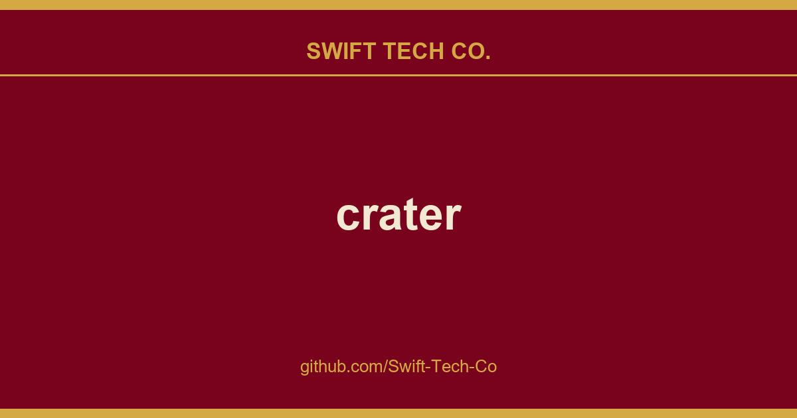

# crater

## What This Is

We keep a working index for product and engineering, and crater is the entry that collects our notes, examples and fixes. It reflects how Swift Tech Co. actually uses this in builds and client work.

## Images

## Introduction

Crater is an open-source web & mobile app that helps you track expenses, payments & create professional invoices & estimates.

Web Application is made using Laravel & VueJS while the Mobile Apps are built using React Native.

## Documentation

- [Installation Steps](https://github.com/Swift-Tech-Co/crater)
- [User Guide](https://github.com/Swift-Tech-Co/crater)
- [Developer Guide](https://github.com/Swift-Tech-Co/crater)
- [API Documentation](https://github.com/Swift-Tech-Co/crater)

## Download

- [Download Link](https://github.com/Swift-Tech-Co/crater)

## Mobile Apps

- [Android](https://github.com/Swift-Tech-Co/crater)
- [IOS](https://github.com/Swift-Tech-Co/crater)
- [Source](https://github.com/Swift-Tech-Co/crater)

## Telegram

Join the Crater telegram to discuss:
[Invite Link](https://t.me/+Qt_eFvkb2rliMzNh)

## Roadmap

~~Here's a rough roadmap of things to come (not in any specific order):

- [x] Automatic Update
- [x] Email Configuration
- [x] Installation Wizard
- [x] Address Customisation & Default notes
- [x] Edit Email before Sending Invoice
- [x] Available as a docker image
- [x] Performance Improvements
- [x] Customer View page
- [x] Add and Use Custom Fields on Invoices & Estimates.
- [x] Multiple Companies
- [x] Recurring Invoices
- [x] Customer Portal
- [x] Accept Payments (Stripe Integration)
- [x] White Labeling (Easy Invoice, Email & Consumer Portal Theme customisation)
- [ ] Modules API
- [ ] Blockchain Integration
- [ ] Web 3.0 Accounting
- [ ] Vendors & Bills
- [ ] Inventory Management 
- [ ] Payment Reminders
- [ ] Improve Accessibility
- [ ] Time Tracking
- [ ] Full service Payroll

## Copyright

© 2022 Crater Invoice, Inc.

**Special thanks to:**

- [Birkhoff Lee](https://github.com/Swift-Tech-Co/crater)
- [Akaunting](https://github.com/Swift-Tech-Co/crater)
- [MakerLab](https://github.com/Swift-Tech-Co/crater)
- [Sebastian Cretu](https://github.com/Swift-Tech-Co/crater)
- [Florian Gareis](https://github.com/Swift-Tech-Co/crater)

## Translate

Help us translate on https://github.com/Swift-Tech-Co/crater

**Thanks to Translation Contributors:**

- [Hassan A. Ba Abdullah (Arabic)](https://github.com/Swift-Tech-Co/crater)
- [Clément de Louvencourt (French)](https://github.com/Swift-Tech-Co/crater)
- [Robin Delattre (French)](https://github.com/Swift-Tech-Co/crater)
- [René Loos (Dutch)](https://github.com/Swift-Tech-Co/crater)
- [Stefan Azarić (Serbian)](https://github.com/Swift-Tech-Co/crater)
- [Emmanuel Lampe (German)](https://github.com/Swift-Tech-Co/crater)
- [edevrob (Latvian)](https://github.com/Swift-Tech-Co/crater)

## License

Crater is released under the GNU AFFERO GENERAL PUBLIC LICENSE Version 3.
See [LICENSE](LICENSE) for details.

---

## Swift Tech Co.

Built and maintained by Swift Tech Co.

AI Automation | FinTech Platforms | Custom Software and Mobile Apps | SaaS Platforms | Cloud Infrastructure | Cybersecurity | SEO and Marketing | API Integration

**Join our community on Telegram:** [t.me/+Qt_eFvkb2rliMzNh](https://t.me/+Qt_eFvkb2rliMzNh)

[Home](https://github.com/Swift-Tech-Co/crater) | [Services](https://github.com/Swift-Tech-Co/crater/services) | [Careers](https://github.com/Swift-Tech-Co/crater/careers) | [Referral Program](https://github.com/Swift-Tech-Co/crater/referral) | [Influencers](https://github.com/Swift-Tech-Co/crater/influencers) | [About](https://github.com/Swift-Tech-Co/crater/about) | [Contact](https://github.com/Swift-Tech-Co/crater/contact)

**Connect**

- Website: [https://github.com/Swift-Tech-Co/crater](https://github.com/Swift-Tech-Co/crater)
- LinkedIn: [linkedin.com/in/stephenoladoke](https://www.linkedin.com/in/stephenoladoke/)
- LinkedIn (Company): [linkedin.com/company/swift-tech-co](https://www.linkedin.com/company/swift-tech-co)
- X: [@MrOladoke](https://x.com/MrOladoke)
- Instagram: [@mr.oladoke](https://www.instagram.com/mr.oladoke/)
- Organization: [github.com/Swift-Tech-Co](https://github.com/Swift-Tech-Co)

## Sources

Compiled and maintained from upstream [crater-invoice-inc/crater](https://github.com/crater-invoice-inc/crater) under permissive open-source license.

---

Maintained by [Swift Tech Co.](https://github.com/Swift-Tech-Co) - [Telegram](https://t.me/+Qt_eFvkb2rliMzNh)